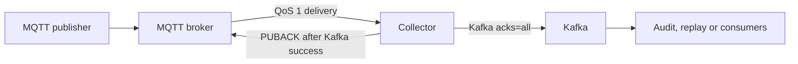

# MQTT → Kafka Collector

[](https://adoptium.net/temurin/releases/?version=21)
[](LICENSE)
[](.github/workflows/ci.yml)
[](#build-and-tests)

A standalone **MQTT 5 → Kafka** service that preserves payload bytes. Use it to capture measurements, binary messages or events for later audit,
replay and processing. It does not transform payloads or replay them to MQTT.



**Status:** early release with automated broker integration tests. Tested failures
are described below; they do not prove losslessness for every broker configuration.
Apache-2.0 licensed. All example topics and addresses are generic.

## When to use it

Use this collector when you need a small, independently deployable archive path from MQTT
to Kafka and can use a stable MQTT client ID with a persistent QoS-1 session.

It is not intended for exactly-once processing, multiple active replicas sharing a client
ID, a disk-backed message spool, automatic topic creation, payload conversion or Kafka
Connect-style connector management. A Kafka write that succeeds before a PUBACK is lost
may be redelivered after restart, so downstream consumers must tolerate duplicates.

## QoS and delivery semantics

| Incoming delivery | Behavior |
| --- | --- |
| **QoS 1** | Send MQTT PUBACK only after Kafka reports successful delivery. On failure leave it unacknowledged and exit so the supervisor can restart the persistent session. |
| **QoS 0, `best-effort` (default)** | Archive when possible. There is no MQTT acknowledgement or broker redelivery guarantee. Full buffer or oversized payload: count and discard this message without stopping the service. |
| **QoS 0, `reject`** | Count and discard the message; keep the service running. Useful when only QoS 1 should be archived. |
| QoS 2 | No QoS-2 subscriber handshake. The subscription requests QoS 1, so a broker normally delivers a publisher's QoS-2 message at QoS 1. |

Use **QoS 1 at the publisher** for data that must be recoverable. Subscribing at QoS 1
cannot upgrade a QoS-0 publication. `MQTT_QOS0_POLICY=reject` is a filter, not a way
to make publishers reliable.

The delivery model is at least once under explicit MQTT-session, broker and Kafka-topic
prerequisites. Kafka producer idempotence does not deduplicate MQTT redelivery across
restarts. See [operations](docs/operations.md) for the delivery prerequisites and failure
behavior.

## Quick start with local test brokers

Requires Docker Engine and Docker Compose v2+. From the project directory:

```bash
docker compose -p mqtt-kafka-demo -f examples/compose.yaml up -d --build
curl -f http://localhost:8080/ready
# Wait for /ready to return HTTP 200 before publishing.
docker compose -p mqtt-kafka-demo -f examples/compose.yaml exec mqtt \
  mosquitto_pub -h localhost -V mqttv5 -q 1 -t sensors/device-1/temperature \
  -m '{"messageSeqId":1,"value":21.5}'
docker compose -p mqtt-kafka-demo -f examples/compose.yaml exec kafka \
  /opt/kafka/bin/kafka-console-consumer.sh --bootstrap-server kafka:9092 \
  --topic mqtt.raw.v1 --from-beginning --max-messages 1
curl -fsS http://localhost:8080/metrics
```

The example creates a topic with three partitions and exposes the collector's HTTP
port only on localhost. It uses anonymous MQTT and plaintext Kafka for local evaluation.
To remove this demo, including its disposable volumes:

```bash
docker compose -p mqtt-kafka-demo -f examples/compose.yaml down --volumes
```

### Connect existing brokers

1. Pre-create the destination Kafka topic(s).
2. Copy `.env.example` to `.env` and set addresses reachable **from the container**.
3. Run `docker compose up -d --build` using the root Compose file.
4. Check `http://localhost:8080/ready` and `docker compose logs collector`.

`localhost` inside the collector means the collector container. The root Compose file
only starts the collector; it does not create brokers. Do not commit `.env` or credentials.

## Configuration

Common aliases are supplied by the bundled `application.yml`:

| Variable | Default | Purpose |
| --- | --- | --- |
| `MQTT_URI` | `tcp://localhost:1883` | MQTT 5 endpoint; takes precedence over host/port |
| `MQTT_HOST`, `MQTT_PORT` | `localhost`, `1883` | Alternative to `MQTT_URI` |
| `MQTT_TLS` | `false` | Converts a `tcp://` URI to `ssl://` |
| `MQTT_CLIENT_ID` | `mqtt-kafka-collector` | Stable and unique per instance |
| `MQTT_TOPIC` | `#` | Subscription filter; narrow it in production |
| `MQTT_USERNAME`, `MQTT_PASSWORD` | empty | Optional broker credentials |
| `MQTT_QOS0_POLICY` | `best-effort` | `best-effort` or `reject` |
| `MQTT_PERSISTENCE_DIRECTORY` | `/app/state` | Writable Paho state directory |
| `KAFKA_BOOTSTRAP_SERVERS` | `localhost:9092` | Comma-separated Kafka bootstrap servers |
| `KAFKA_TOPIC` | `mqtt.raw.v1` | Default destination |
| `KAFKA_PARTITIONING` | `murmur2` | `murmur2` (Java default) or `crc32` |
| `COLLECTOR_ROLE` | `mqtt-kafka-collector` | Role recorded in Kafka headers |
| `METRICS_PREFIX` | `collector` | Prefix for collector metrics |
| `SERVER_PORT` | `8000` | HTTP listener |

For routing, buffer limits, TLS/SASL and additional Kafka settings, mount a read-only
`/config/application.yaml` and set
`SPRING_CONFIG_ADDITIONAL_LOCATION=file:/config/`. See [configuration](docs/configuration.md) for the complete example and TLS/SASL settings.

All destination topics are static and must exist. The collector checks them at startup;
disable broker auto-creation and use appropriate Kafka ACLs. Run exactly one active
collector for an MQTT client ID.

## Routing and ordering

Optional ordered Java regex rules choose one Kafka topic and key. The first matching
rule wins; the fallback handles everything else. There is no fan-out.

```yaml
collector:
  mapping:
    default-topic: mqtt.raw.v1
    default-key: '{topic}'
    rules:
      - pattern: '^sensors/(?<device>[^/]+)/telemetry$'
        kafka-topic: mqtt.telemetry.v1
        kafka-key: '{device}'
      - pattern: '^sensors/(?<device>[^/]+)/events$'
        kafka-topic: mqtt.events.v1
        kafka-key: '{device}'
```

All destination topics are static and must exist. Restart after configuration changes.
Keys support `{topic}` and Java named regex groups such as `{device}`. Payloads are never
parsed. Kafka ordering is per partition; use a device key when related MQTT topics must
share one partition. See [architecture and ordering](docs/architecture.md).

The value is the exact MQTT payload bytes, including binary and empty data. The key,
timestamp and Kafka headers are defined in [the record format](docs/record-format.md).

## HTTP endpoints and metrics

| Path | Meaning |
| --- | --- |
| `/health` | Process liveness; no broker checks |
| `/ready` | HTTP 200 when subscribed, MQTT connected and Kafka readiness is positive; otherwise 503 |
| `/metrics` | Prometheus text format |
| `/actuator/health` | Spring health including collector readiness |
| `/actuator/info` | Application/build information |
| `/actuator/prometheus` | Actuator's Prometheus endpoint |

Use `/health` for liveness and `/ready` for readiness. The Kafka probe runs every 30 seconds. Keep the HTTP listener on a trusted network; these endpoints have no built-in authentication.

Important counters include `collector_received_total`, `collector_delivered_total`, `collector_mqtt_acked_total`, `collector_rejected_total` and `collector_overflow_total`. The full metric reference and interpretation are in [operations](docs/operations.md).

## Build and tests

```bash
# Java 21 and Maven 3.9+
mvn -B -ntp verify
# Or use the Docker build, which also runs the Java tests:
docker build -t mqtt-kafka-collector:integration .
# Python 3.10+ standard library, Docker Engine and Compose v2+:
python3 tests/integration/run.py
```

The integration runner starts its own Mosquitto 2.0.22 and Apache Kafka 3.9.1 on an internal Docker network with no published ports. It checks payload preservation, headers, routing, ordering, QoS behavior, Kafka and MQTT failures, SIGKILL recovery, buffer overflow, CRC32 compatibility, missing topics and HTTP endpoints. Logs are written to `target/integration/`.

The suite demonstrates specific failure paths; it is not a universal zero-loss proof. Authenticated TLS/SASL handshakes, multi-broker failover, long-duration load and host power loss need separate validation.

## Documentation

- [Architecture and ordering](docs/architecture.md)
- [Configuration and TLS/SASL](docs/configuration.md)
- [Kafka record format](docs/record-format.md)
- [Operations, metrics and delivery limits](docs/operations.md)

## License

[Apache License 2.0](LICENSE). The runtime image includes `/app/LICENSE` and an OCI license
label. Dependencies retain their respective licenses.
